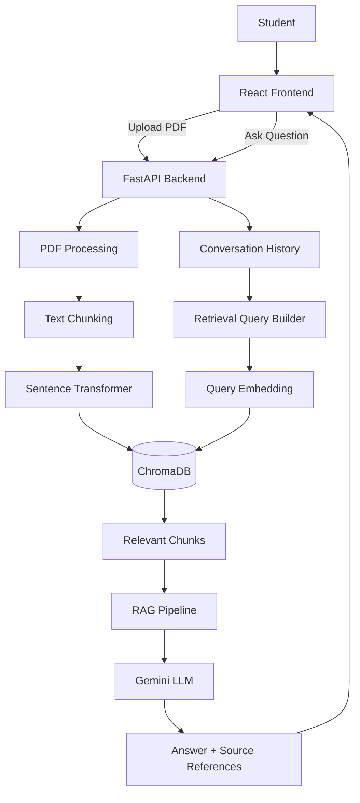

# StudyMate AI

An AI-powered study assistant that uses Retrieval-Augmented Generation (RAG) to answer questions based on uploaded lecture materials.

StudyMate AI allows students to upload PDF lectures, retrieve relevant study content using semantic search, and ask questions through a conversational chat interface. Answers are generated using retrieved course material and include source references to the relevant pages and chunks.

## Features

- Upload lecture PDFs
- Extract text from PDF documents
- Split documents into overlapping text chunks
- Generate semantic embeddings using Sentence Transformers
- Store and search embeddings using ChromaDB
- Retrieve relevant lecture content using semantic search
- Generate answers using Gemini
- Conversation-aware question retrieval
- Source and page references for generated answers
- View uploaded study materials
- Delete indexed documents
- REST API built with FastAPI
- React frontend
- Dockerized frontend and backend
- Automated evaluation and backend tests

## Architecture



## RAG Pipeline

StudyMate AI follows a Retrieval-Augmented Generation pipeline.

### 1. Document Ingestion

When a PDF is uploaded, the backend extracts text from each page using `pypdf`.

```text
PDF
 ↓
PDF text extraction
 ↓
Page-level text
```

Each page keeps its page number so that retrieved information can later be traced back to the original lecture.

### 2. Text Chunking

Extracted page text is divided into overlapping chunks.

The current configuration uses:

- Chunk size: 1000 characters
- Chunk overlap: 150 characters

The overlap helps preserve context between neighboring chunks.

```text
Lecture text
    ↓
Chunk 1
    ↓
Chunk 2
    ↓
Chunk 3
```

Each chunk stores metadata including:

- Source filename
- Page number
- Chunk index

### 3. Embedding Generation

Each chunk is converted into a numerical vector using:

```text
all-MiniLM-L6-v2
```

The resulting embeddings have 384 dimensions.

```text
Text chunk
   ↓
Sentence Transformer
   ↓
384-dimensional vector
```

### 4. Vector Storage

Embeddings are stored in ChromaDB.

The application uses the collection:

```text
lecture_documents
```

When a document with the same source is uploaded again, its previous chunks are removed before the new chunks are indexed. This prevents stale document data from remaining in the vector database.

### 5. Query Retrieval

When a student asks a question, StudyMate AI converts the question into an embedding and searches ChromaDB for the most semantically similar chunks.

The system currently retrieves the top 3 results.

A distance threshold is also used to prevent irrelevant material from being passed to the language model.

```text
User question
     ↓
Query embedding
     ↓
ChromaDB semantic search
     ↓
Top 3 relevant chunks
     ↓
Relevance filtering
```

The current retrieval distance threshold is:

```text
1.5
```

### 6. Conversation-Aware Retrieval

StudyMate AI also supports conversational follow-up questions.

For example:

```text
User:
What is RAG?

Assistant:
RAG stands for Retrieval-Augmented Generation...

User:
What are its main components?
```

The second question may not contain enough context by itself.

The system therefore combines recent user questions with the current question before generating the retrieval embedding.

```text
Previous questions
       +
Current question
       ↓
Retrieval query
       ↓
Embedding
       ↓
Semantic search
```

The system keeps the most recent three user questions for retrieval.

### 7. Context Construction

Retrieved chunks that satisfy the relevance threshold are combined into a context block.

Each context section contains source metadata such as:

```text
Source: Week01_AI_Study_Assistant_Lecture.pdf
Page: 1
```

### 8. Answer Generation

The retrieved context is passed to Gemini together with:

- Conversation history
- Current question
- Retrieved study material
- RAG-specific instructions

The model is instructed to use the provided study materials as the primary factual source and avoid inventing information.

```text
Retrieved context
      +
Conversation history
      +
Current question
      ↓
    Gemini
      ↓
Generated answer
```

If the retrieved study materials do not contain enough information to answer the question, the system instructs the model to respond:

```text
I could not find the answer in the provided study materials.
```

### 9. Source Attribution

The backend returns source information together with the generated answer.

Each source contains:

- Filename
- Page number
- Chunk index
- Retrieval distance

This allows the frontend to show where the answer came from.

## Tech Stack

### Frontend

- React
- Vite
- JavaScript
- HTML/CSS

### Backend

- Python
- FastAPI
- Uvicorn
- Pydantic

### AI / RAG

- Google Gemini
- Sentence Transformers
- `all-MiniLM-L6-v2`
- ChromaDB
- Retrieval-Augmented Generation

### Document Processing

- pypdf

### Testing

- Pytest
- Backend unit and integration tests
- RAG evaluation

### Deployment

- Docker
- Docker Compose
- Nginx

## Project Structure

```text
AI Study Assistant (RAG)/
│
├── backend/
│   ├── app/
│   │   ├── chunker.py
│   │   ├── document_processor.py
│   │   ├── embedding_service.py
│   │   ├── ingestion.py
│   │   ├── llm_service.py
│   │   ├── main.py
│   │   ├── rag_pipeline.py
│   │   ├── schemas.py
│   │   └── vector_store.py
│   │
│   ├── evaluation/
│   ├── index_documents.py
│   ├── search_documents.py
│   ├── test_chunker.py
│   ├── test_document_processor.py
│   ├── test_embeddings.py
│   ├── test_gemini.py
│   ├── test_ingestion.py
│   ├── test_rag.py
│   ├── test_similarity.py
│   └── Dockerfile
│
├── frontend/
│   ├── public/
│   ├── src/
│   │   ├── App.jsx
│   │   ├── App.css
│   │   ├── index.css
│   │   └── main.jsx
│   ├── package.json
│   └── Dockerfile
│
├── data/
│   ├── documents/
│   └── processed/
│
├── chroma_db/
│
├── docker-compose.yml
├── requirements.txt
├── .dockerignore
├── .gitignore
└── README.md
```

## API Endpoints

The FastAPI backend exposes the following endpoints.

| Method | Endpoint | Description |
|---|---|---|
| GET | `/` | Health/root endpoint |
| POST | `/ask` | Ask a question using the RAG pipeline |
| POST | `/upload` | Upload and index a PDF |
| GET | `/documents` | List indexed documents |
| DELETE | `/documents/{filename}` | Delete an indexed document |

FastAPI also provides automatically generated API documentation through Swagger UI.

When running the application locally or with Docker, Swagger UI is available at:

```text
http://localhost:8000/docs
```

## Getting Started

### Requirements

For Docker-based setup:

- Docker
- Docker Compose
- Git

For local development:

- Python 3.11+
- Node.js 20+
- npm
- Git

### Environment Variables

Create a `.env` file in the project root:

```env
GEMINI_API_KEY=your_api_key_here
```

Do not commit `.env` or API keys to GitHub.

### Run with Docker

Docker is the recommended way to run the complete application.

From the project root:

```powershell
docker compose build
```

Start the application:

```powershell
docker compose up -d
```

Check the running services:

```powershell
docker compose ps
```

The frontend will be available at:

```text
http://localhost:5173
```

The backend will be available at:

```text
http://localhost:8000
```

Swagger API documentation will be available at:

```text
http://localhost:8000/docs
```

To stop the application:

```powershell
docker compose down
```

### Local Backend Development

If you want to run the backend directly without Docker:

Move into the backend directory:

```powershell
cd backend
```

Activate the Python virtual environment from the project root:

```powershell
..\.venv\Scripts\Activate.ps1
```

Install dependencies from the project root:

```powershell
cd ..
pip install -r requirements.txt
```

Then return to the backend directory:

```powershell
cd backend
```

Run FastAPI:

```powershell
uvicorn app.main:app --reload
```

The API will be available at:

```text
http://localhost:8000
```

### Local Frontend Development

Move into the frontend directory:

```powershell
cd frontend
```

Install dependencies:

```powershell
npm install
```

Run the development server:

```powershell
npm run dev
```

The frontend will be available at:

```text
http://localhost:5173
```

## Docker

The project includes Docker support for running the frontend and backend together.

The Docker setup contains:

```text
React Frontend
      ↓
Nginx
      ↓
FastAPI Backend
      ↓
RAG Pipeline
      ↓
ChromaDB + Gemini
```

The backend also uses persistent Docker volumes for:

- ChromaDB data
- Uploaded documents

This allows indexed data and uploaded files to persist across container restarts.

## Example Usage

### 1. Upload a Lecture

Upload a PDF through the StudyMate AI interface.

The backend will:

```text
PDF
 ↓
Extract text
 ↓
Create chunks
 ↓
Generate embeddings
 ↓
Store vectors in ChromaDB
```

### 2. Ask a Question

For example:

```text
What is RAG?
```

The system retrieves relevant lecture chunks and sends them to Gemini.

Example response:

```text
RAG stands for Retrieval-Augmented Generation.

It is a system that first retrieves relevant information
from an external knowledge base and then provides that
context to a language model to generate an answer.
```

The response also includes source information such as the lecture filename and page number.

## Evaluation and Testing

The project includes backend tests covering major components of the RAG system.

Testing areas include:

- PDF document processing
- Text chunking
- Embedding generation
- Similarity search
- Document ingestion
- Gemini integration
- RAG pipeline behavior

The project also includes an evaluation suite for testing conversational follow-up questions.

Run the test suite with:

```powershell
pytest
```

## Engineering Decisions

### Why RAG?

A general-purpose language model does not automatically know the contents of a student's private lecture materials.

RAG allows the system to retrieve relevant course content before generating an answer.

This reduces the need to fine-tune a model for every new collection of lecture documents.

### Why ChromaDB?

ChromaDB provides a lightweight vector database suitable for a student-scale RAG application.

It allows lecture embeddings to be stored and searched using semantic similarity.

### Why Sentence Transformers?

`all-MiniLM-L6-v2` provides relatively lightweight sentence embeddings while producing useful semantic representations for document retrieval.

### Why Conversation-Aware Retrieval?

A follow-up question such as:

```text
What are its main components?
```

may be difficult to retrieve accurately without knowing what "its" refers to.

Including recent user questions helps provide additional retrieval context.

### Why Source References?

Showing the document, page, and chunk used for retrieval makes the system more transparent and helps students verify the information.

## Current Limitations

- The system currently focuses on text-based PDF content.
- Image-heavy or scanned PDFs may require OCR support.
- The vector database is currently local rather than hosted.
- The application does not currently implement user authentication.
- Retrieval quality depends on document quality and chunking strategy.
- The system currently uses a fixed retrieval threshold.
- The frontend API URL is currently hard-coded for local development.

## Future Improvements

Potential future improvements include:

- OCR support for scanned lecture PDFs
- Better chunking strategies
- Hybrid keyword + semantic retrieval
- Reranking retrieved documents
- Streaming LLM responses
- User authentication
- Persistent conversation storage
- Cloud deployment
- Hosted vector database
- Improved evaluation metrics
- More advanced citation handling
- Configurable retrieval parameters
- Multi-user study workspaces

## Project Status

StudyMate AI currently includes:

- PDF ingestion
- Document chunking
- Semantic embeddings
- Vector search
- Retrieval-Augmented Generation
- Gemini-powered generation
- Conversation-aware retrieval
- Source attribution
- PDF upload
- Document management
- React frontend
- FastAPI backend
- Docker deployment
- Automated testing

The project is currently in the documentation and portfolio preparation stage.

## License

This project is currently intended as a personal learning and portfolio project.