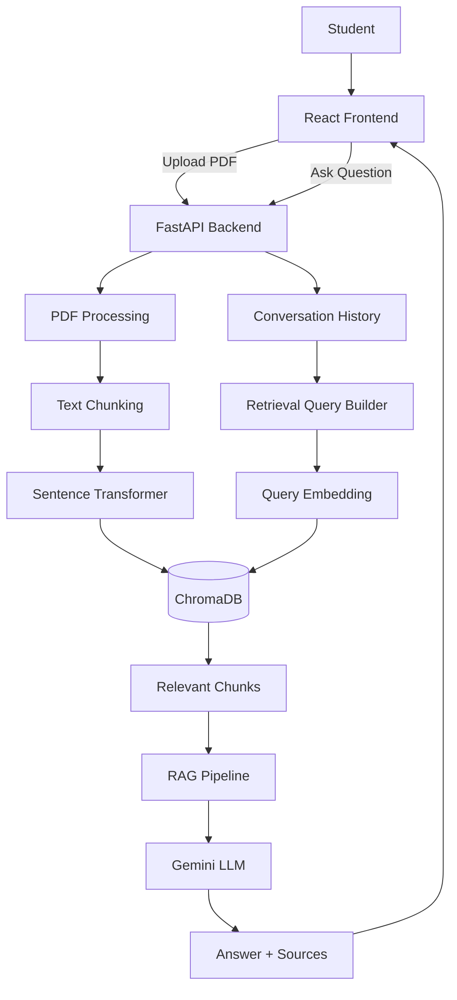

# StudyMate AI

**StudyMate AI** is an AI-powered study assistant that uses **Retrieval-Augmented Generation (RAG)** to answer questions from uploaded lecture materials.

Students can upload PDF lectures, retrieve relevant content using semantic search, and ask questions through a conversational chat interface. Answers are generated from retrieved study materials and include source references such as the document name, page, and chunk.

## Live Demo

- **Frontend:** https://studymate-ai-jzsm.onrender.com/
- **Backend API:** https://ai-study-assistant-rag-9tab.onrender.com/
- **Swagger API Docs:** https://ai-study-assistant-rag-9tab.onrender.com/docs
- **GitHub:** https://github.com/lamquangnhat/ai-study-assistant-rag

> The deployed version is a student-scale portfolio/demo application running on Render.

## Features

- Upload lecture PDFs
- Extract text from PDF documents
- Split documents into overlapping chunks
- Generate semantic embeddings using Sentence Transformers
- Store and search embeddings with ChromaDB
- Semantic retrieval of relevant lecture content
- Gemini-powered answer generation
- Conversation-aware retrieval for follow-up questions
- Source and page references for answers
- View uploaded study materials
- Delete indexed documents
- FastAPI REST API
- React + Vite frontend
- Dockerized frontend and backend
- Automated backend tests and RAG evaluation
- Production deployment with Render

## Architecture



## RAG Pipeline

### 1. Document Ingestion

When a PDF is uploaded, the backend extracts text from each page using `pypdf`.

```text
PDF
 ↓
PDF text extraction
 ↓
Page-level text
```

Page numbers are preserved so retrieved information can be traced back to the original lecture.

### 2. Text Chunking

Extracted text is divided into overlapping chunks.

Current configuration:

- **Chunk size:** 1000 characters
- **Chunk overlap:** 150 characters

```text
Lecture text
    ↓
Chunk 1
    ↓
Chunk 2
    ↓
Chunk 3
```

Each chunk stores metadata including:

- Source filename
- Page number
- Chunk index

### 3. Embedding Generation

Each chunk is converted into a vector using:

```text
all-MiniLM-L6-v2
```

The resulting embeddings have **384 dimensions**.

```text
Text chunk
   ↓
Sentence Transformer
   ↓
384-dimensional vector
```

### 4. Vector Storage

Embeddings are stored in ChromaDB using the collection:

```text
lecture_documents
```

When the same document is uploaded again, its previous chunks are removed before re-indexing to prevent stale vector data.

### 5. Semantic Retrieval

When a student asks a question, the question is converted into an embedding and searched against ChromaDB.

The current system retrieves the top 3 results and applies a relevance distance threshold.

```text
User question
     ↓
Query embedding
     ↓
ChromaDB semantic search
     ↓
Top 3 relevant chunks
     ↓
Relevance filtering
```

Current retrieval distance threshold:

```text
1.5
```

### 6. Conversation-Aware Retrieval

StudyMate AI supports follow-up questions.

Example:

```text
User:
What is RAG?

Assistant:
RAG stands for Retrieval-Augmented Generation...

User:
What are its main components?
```

The second question may not contain enough context by itself. The system therefore combines recent user questions with the current question before generating the retrieval embedding.

The most recent **three user questions** are considered for retrieval context.

### 7. Context Construction

Relevant chunks are combined into a context block.

Each section includes source metadata such as:

```text
Source: Week01_AI_Study_Assistant_Lecture.pdf
Page: 1
```

### 8. Answer Generation

The retrieved context is passed to Gemini together with:

- Conversation history
- Current question
- Retrieved study material
- RAG-specific instructions

The model is instructed to prioritize the provided study materials and avoid inventing unsupported information.

If the retrieved materials do not contain enough information, the system uses:

```text
I could not find the answer in the provided study materials.
```

### 9. Source Attribution

The backend returns source information together with the generated answer.

Each source can include:

- Filename
- Page number
- Chunk index
- Retrieval distance

This allows the frontend to show where the answer came from.

## Tech Stack

### Frontend

- React
- Vite
- JavaScript
- HTML/CSS

### Backend

- Python 3.11
- FastAPI
- Uvicorn
- Pydantic

### AI / RAG

- Google Gemini
- Sentence Transformers
- `all-MiniLM-L6-v2`
- ChromaDB
- Retrieval-Augmented Generation

### Document Processing

- pypdf

### Testing

- Pytest
- Backend unit/integration tests
- RAG evaluation

### Deployment

- Docker
- Docker Compose
- Nginx
- Render

## Project Structure

```text
AI Study Assistant (RAG)/
│
├── backend/
│   ├── app/
│   │   ├── chunker.py
│   │   ├── document_processor.py
│   │   ├── embedding_service.py
│   │   ├── ingestion.py
│   │   ├── llm_service.py
│   │   ├── main.py
│   │   ├── rag_pipeline.py
│   │   ├── schemas.py
│   │   └── vector_store.py
│   │
│   ├── evaluation/
│   ├── index_documents.py
│   ├── search_documents.py
│   ├── test_chunker.py
│   ├── test_document_processor.py
│   ├── test_embeddings.py
│   ├── test_gemini.py
│   ├── test_ingestion.py
│   ├── test_rag.py
│   ├── test_similarity.py
│   └── Dockerfile
│
├── frontend/
│   ├── public/
│   ├── src/
│   │   ├── App.jsx
│   │   ├── App.css
│   │   ├── index.css
│   │   └── main.jsx
│   ├── package.json
│   └── Dockerfile
│
├── data/
│   ├── documents/
│   └── processed/
│
├── chroma_db/
│
├── docker-compose.yml
├── requirements.txt
├── .dockerignore
├── .gitignore
└── README.md
```

## API Endpoints

| Method | Endpoint | Description |
|---|---|---|
| GET | `/` | Health/root endpoint |
| POST | `/ask` | Ask a question using the RAG pipeline |
| POST | `/upload` | Upload and index a PDF |
| GET | `/documents` | List indexed documents |
| DELETE | `/documents/{filename}` | Delete an indexed document |

Swagger UI is automatically generated by FastAPI:

```text
http://localhost:8000/docs
```

For the deployed backend:

```text
https://ai-study-assistant-rag-9tab.onrender.com/docs
```

## Getting Started

### Requirements

For Docker:

- Docker
- Docker Compose
- Git

For local development:

- Python 3.11+
- Node.js 20+
- npm
- Git

### Environment Variables

Create a `.env` file in the project root:

```env
GEMINI_API_KEY=your_api_key_here
```

The API key must not be committed to GitHub.

The frontend uses:

```env
VITE_API_URL=http://127.0.0.1:8000
```

For production, the frontend is configured with the deployed backend URL through the Render environment variable:

```text
VITE_API_URL=https://ai-study-assistant-rag-9tab.onrender.com
```

### Run with Docker

From the project root:

```powershell
docker compose build
```

Start the application:

```powershell
docker compose up -d
```

Check services:

```powershell
docker compose ps
```

Local URLs:

```text
Frontend: http://localhost:5173
Backend:  http://localhost:8000
Swagger:  http://localhost:8000/docs
```

Stop the application:

```powershell
docker compose down
```

### Local Backend Development

Move into the backend directory:

```powershell
cd backend
```

Activate the virtual environment:

```powershell
..\.venv\Scripts\Activate.ps1
```

Install dependencies:

```powershell
cd ..
pip install -r requirements.txt
```

Run FastAPI:

```powershell
cd backend
uvicorn app.main:app --reload
```

Backend:

```text
http://localhost:8000
```

### Local Frontend Development

Move into the frontend directory:

```powershell
cd frontend
```

Install dependencies:

```powershell
npm install
```

Run the development server:

```powershell
npm run dev
```

Frontend:

```text
http://localhost:5173
```

## Docker Deployment

The project includes Docker support for running the frontend and backend together.

```text
React Frontend
      ↓
    Nginx
      ↓
FastAPI Backend
      ↓
  RAG Pipeline
      ↓
ChromaDB + Gemini
```

The backend Docker image uses **CPU-only PyTorch** to keep the deployment lightweight and suitable for the available Render instance resources.

For local Docker development, ChromaDB and uploaded documents are bind-mounted:

```yaml
volumes:
  - ./chroma_db:/app/chroma_db
  - ./data:/app/data
```

This allows local indexed data and uploaded files to persist across local container restarts.

## Production Deployment

The current production deployment uses **Render**:

```text
                    Render
                      │
          ┌───────────┴───────────┐
          │                       │
    Static Frontend          Backend Web Service
      React + Nginx               FastAPI
          │                       │
          └───────────┬───────────┘
                      │
                RAG Pipeline
                      │
              ChromaDB + Gemini
```

Production services:

- Frontend: Render Static Site
- Backend: Render Web Service
- Backend runtime: Docker
- Frontend server: Nginx
- AI generation: Google Gemini

### Production Environment

The backend requires:

```text
GEMINI_API_KEY
```

The frontend requires:

```text
VITE_API_URL=https://ai-study-assistant-rag-9tab.onrender.com
```

CORS is configured to allow the production frontend together with local development.

> **Important:** The current Render Free deployment uses an ephemeral filesystem. Uploaded production documents and local ChromaDB data should therefore be treated as demo/temporary data rather than permanent cloud storage.

## Example Usage

### 1. Upload a Lecture

Upload a PDF through the StudyMate AI interface.

The backend performs:

```text
PDF
 ↓
Extract text
 ↓
Create chunks
 ↓
Generate embeddings
 ↓
Store vectors in ChromaDB
```

### 2. Ask a Question

For example:

```text
What is RAG?
```

The system:

```text
Question
 ↓
Query embedding
 ↓
Semantic retrieval
 ↓
Relevant lecture chunks
 ↓
Gemini
 ↓
Answer + sources
```

The response includes source information such as the lecture filename and page number.

## Evaluation and Testing

The project includes tests covering major components of the RAG system:

- PDF document processing
- Text chunking
- Embedding generation
- Similarity search
- Document ingestion
- Gemini integration
- RAG pipeline behavior
- Conversation-aware follow-up questions

Run the test suite:

```powershell
pytest
```

The conversation-aware RAG evaluation includes a test for follow-up questions such as:

```text
Question 1 → What is RAG?
Question 2 → What are its main components?
```

## Engineering Decisions

### Why RAG?

A general-purpose language model does not automatically know the contents of a student's lecture materials.

RAG retrieves relevant course content before generating an answer, allowing the same system to work with different collections of lecture documents without fine-tuning a model for every course.

### Why ChromaDB?

ChromaDB provides a lightweight vector database suitable for a student-scale RAG application.

It supports storing and searching lecture embeddings using semantic similarity.

### Why Sentence Transformers?

`all-MiniLM-L6-v2` provides lightweight sentence embeddings that are suitable for semantic retrieval while keeping the application practical for local development and low-resource deployment.

### Why Conversation-Aware Retrieval?

A follow-up question such as:

```text
What are its main components?
```

may be difficult to retrieve accurately without knowing what "its" refers to.

Including recent user questions provides additional context for retrieval.

### Why Source References?

Showing the document, page, and chunk used for retrieval makes the system more transparent and allows students to verify the source material.

## Current Limitations

- The system focuses on text-based PDF content.
- Image-heavy or scanned PDFs may require OCR.
- The deployed Render filesystem is ephemeral.
- The current application is designed as a single-user/student-scale portfolio application and does not implement user authentication or multi-user data isolation.
- Retrieval quality depends on document quality and chunking strategy.
- The retrieval threshold is currently fixed.
- ChromaDB is local to the application environment rather than a hosted vector database.
- Conversation history is handled within the current application flow rather than stored in a dedicated persistent database.

## Future Improvements

Possible future improvements include:

- OCR support for scanned lecture PDFs
- Better chunking strategies
- Hybrid keyword + semantic retrieval
- Reranking retrieved documents
- Streaming LLM responses
- User authentication
- Multi-user data isolation
- Persistent conversation storage
- Hosted vector database
- Persistent cloud document storage
- Improved evaluation metrics
- More advanced citation handling
- Configurable retrieval parameters

These are considered future extensions rather than requirements for the current completed version.

## Project Status

**StudyMate AI — Completed student RAG project**

Current completed scope:

- [x] Project setup
- [x] PDF processing
- [x] Text chunking
- [x] Embeddings
- [x] ChromaDB vector storage
- [x] Semantic search
- [x] FastAPI backend
- [x] Gemini integration
- [x] RAG pipeline
- [x] Conversation-aware retrieval
- [x] RAG evaluation
- [x] React frontend
- [x] Frontend ↔ backend integration
- [x] PDF upload
- [x] Chat and conversation UI
- [x] Source/citation display
- [x] Error handling
- [x] End-to-end testing
- [x] Docker
- [x] Production deployment
- [x] README and architecture documentation

The project is intentionally considered **complete at this scope**. Multi-user authentication, persistent cloud storage, and other production-scale features are outside the current version.

## License

This project is currently intended as a personal learning and portfolio project.
